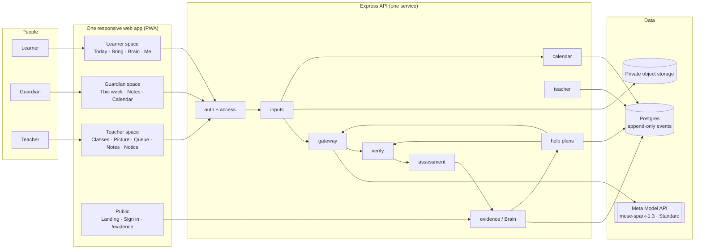
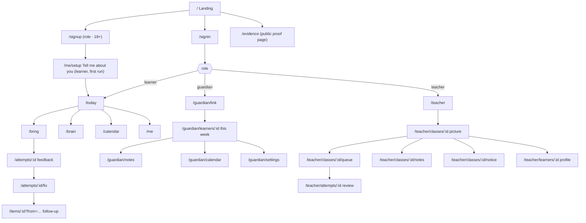

# 05 · Screens, navigation and flows (scope v2, "one learner, three people, one Brain")

**APPROVED 1 Nov 2026 (planning session; D34 scope).** This is the screen-by-screen spec
for the hackathon build and the first release. Every screen lists its route, who sees it,
what is on it, its states, and the acceptance it must pass. Design them in the Sentinel
system (`docs/vision/DESIGN.md`): tokens only, pink means act and never wrong, real work as
the hero, one primary action per screen, no chat bubbles in the core flow.

**What we are building:** a **responsive web application** (one codebase; the layout adapts
to a 360px phone, a 768px tablet and a 1024px+ laptop without anything looking out of
place), **installable as a progressive web app** from a link (no app store), and designed so
the same API can later serve a native mobile app (`06-frontend-pwa-mobile.md`).

## 1. The map



Reading it: every screen talks only to the API; the API talks to the model only through the
gateway; nothing the model says reaches a screen until the verifier has passed it; every
accepted result becomes an append-only event; the Help Plan is written from those events
and rendered three ways.

## 2. Navigation map (the sitemap for this build)



**Tab bars.** On phones each space has a bottom tab bar with at most four tabs; on 1024px
and up the same tabs become a left sidebar. Learner: Today · Bring · Brain · Me. Guardian:
This week · Notes · Calendar · Settings. Teacher: Classes · Queue · Notes · Notice (the class
picture is the Classes tab's detail).

## 3. The core flow

```mermaid
sequenceDiagram
  participant L as Learner (phone)
  participant API as API
  participant GW as Gateway
  participant M as Muse Spark
  participant V as Verifier
  participant DB as Postgres (events)
  participant G as Guardian (phone)
  participant T as Teacher (laptop)
  L->>API: POST /api/inputs (photo of working)
  API->>GW: classify → "work" (schema)
  API->>GW: assess(item, guideline, transcription request)
  GW->>M: chat completion, response_format=json_schema
  M-->>GW: per-step proposal + hint
  GW->>V: runChecks(assess)
  alt checks fail
    V-->>GW: codes (e.g. HINT_LEAKS_ANSWER)
    GW->>M: re-ask with codes (≤3 calls total)
  end
  alt accepted
    V-->>API: accepted
    API->>DB: assessment (written once) + assessed event
    API-->>L: step map · circle on the lost step · hint
    L->>API: POST /api/attempts/:id/fix
    API-->>L: "Fixed on your own" + follow-up item
    API->>DB: fixed_independently event
  else exhausted
    API->>DB: assessment status=uncertain
    API-->>L: "Not sure about this one; your teacher will check"
    API-->>T: appears in the confirm queue
  end
  API->>GW: plan agent (evidence, calendar, profile, resources)
  GW->>V: runChecks(plan)
  API->>DB: help_plan (three views) + plan_issued event
  API-->>L: tonight's step
  API-->>G: this week: the gap (topic level) + one action
  API-->>T: class picture · drafted note (draft)
  T->>API: approve note → send
  API-->>G: the teacher's note
  G->>API: "We did it" → support_given event
```

## 4. Screens

Conventions: **Route** · **Who** · **Purpose** · **On the screen** (top to bottom on a phone)
· **States** · **Acceptance**. Status labels (LIVE / SYNTHETIC / PROTOTYPE / PLANNED) appear
wherever something is not fully built. Copy follows the voice guide: plain, short, never
"AI" in a headline.

### 4.1 Public

**P1 · Landing** · `/` · everyone
- Purpose: say what it is in one breath and get the right person to the right door.
- On the screen: wordmark; headline *Every learner understood. Every next step clearer.*;
  one sentence (*a free learning app for high-school learners that shows them exactly where
  they're stuck, and tells their parent and teacher how to help*); three doors (I'm a
  learner / I'm a parent / I'm a teacher) that lead to sign-up with the role preselected;
  "Sign in"; a status legend row; footer link to `/evidence`; "Built 26 Oct – 4 Nov 2026".
- States: default only.
- Acceptance: no horizontal scroll at 360px; token colours only; the three doors are the only
  pink elements.

**P2 · Sign up** · `/signup?role=` · everyone
- On the screen: role chooser (learner / parent or guardian / teacher); nickname (no real
  name field exists); email; password; the required checkbox "I am 18 or older"; the
  one-line privacy promise (*no ads, nothing about you is sold, nothing you do here trains
  anyone's AI*); Create account.
- States: validation errors inline; attestation unticked blocks submit (server also refuses).
- Acceptance: P0-01 tests.

**P3 · Sign in** · `/signin`
- Email, password, Sign in; link to sign up. On success route by role.

**P4 · Proof page** · `/evidence` · public
- On the screen: model IDs and tier (Standard); prompt versions; the evaluation table with
  denominators and 95% intervals (agreement, confidently wrong, abstained; notice field
  accuracy; plan ratings); "fixed on their own" rate; checks blocked by reason; latency
  p50/p95; cost per learner-week; what works and what doesn't yet; "built during the
  hackathon" list; status legend.
- States: "No evaluation run committed yet" empty state.
- Acceptance: every number read from `evals/results/latest.json` (test).

### 4.2 Learner space

**L0 · Tell me about you** · `/me/setup` · learner, first run
- Purpose: start the Brain with the learner's own words.
- On the screen: four short prompts, one per step: *What do you want to be or do one day?* ·
  *Which subjects are you taking?* · *Which one is hardest right now?* · *How do you like to
  learn: reading, seeing, hearing, doing?* Then the four cards the model produced, each
  editable, with *This is what Guardian Book knows about you. Change anything.*
- States: skip (cards stay empty; Today still works); model not configured (cards from the
  raw text, labelled PROTOTYPE).
- Acceptance: P0-02 tests; raw text never served to a guardian.

**L1 · Today** · `/today` · learner (home)
- Purpose: open → one next step.
- On the screen: greeting with nickname; **exam chip** (*Maths P1 · 12 days*, from confirmed
  calendar events); **Tonight's step card** (from the Help Plan's learner view: the gap in
  one line, the step, why it matters for the dream, a *Start* button); the **Bring anything**
  button (large, pink, the one primary action); **Recent** list (last three inputs with
  status: feedback ready / your teacher is checking / fixed); a quiet line if no guardian is
  linked (*Invite a parent so they know how to help*).
- States: first day (no plan yet: *Bring something and we'll start*); uncertain attempts
  waiting; no calendar.
- Acceptance: one pink primary; loads under 2.5 s on a 3G-class profile; 360px clean.

**L2 · Bring anything** · `/bring` · learner
- Purpose: one capture for everything.
- On the screen: three big targets: **Snap** (camera or file; photo or PDF), **Type**,
  **Ask** (a question about a step; voice when P1-a lands, labelled PLANNED until then);
  after capture, a **what-is-this** chip (*Homework · Notice · Question*) the learner can
  change; if homework, the item picker (approved items; recent first).
- States: uploading; too large / wrong type; classification uncertain (chip asks *Which is
  it?*); offline (queue PLANNED; for now a clear message).
- Acceptance: P0-03 tests; EXIF stripped; object never public.

**L3 · Feedback** · `/attempts/:id` · learner (owner)
- Purpose: the learner's own page, understood.
- On the screen: the learner's **own working** (photo or text) as the hero; the **step
  map** beside or beneath it (✓ ✓ ✗ per step, marks small); the **circle** on the lost step
  (P1-c; until then a highlighted step row); **where it slipped** (the step name and the
  evidence quote from their working); **the hint** (never the answer); confidence label;
  the **Fix it** button (pink); if `uncertain`: *We're not sure about this one. Your teacher
  will check it.* and no marks shown.
- States: proposed; uncertain; failed (retry); teacher-confirmed (badge *Teacher-confirmed*
  and any adjusted marks).
- Acceptance: the guideline is never visible before an attempt exists; no mastery claim
  after one attempt; hint never contains the final answer (verifier test).

**L4 · Fix it** · `/attempts/:id/fix` · learner
- On the screen: the broken step restated; a Type or Snap area for the redo; **Check**.
  Result: ✓ *Fixed on your own* (with the Sentinel crest fanning) or the next hint; then
  **One more like it** (the follow-up item with *why this*).
- Acceptance: P0-05 tests.

**L5 · Follow-up question** · `/items/:id?from=:attemptId` · learner
- On the screen: the item rendered (KaTeX); *Why this: you lost step 3 on the last one*;
  Type or Snap; Check → L3 for the new attempt.

**L6 · Brain** · `/brain` · learner
- Purpose: *what Guardian Book believes about you, and the evidence.*
- On the screen: **skill map** (chips per skill: new / practising / secure, teal for
  secure, hollow for new; tap a chip → the evidence events behind it); **growth timeline**
  (events in order: attempts, fixes, teacher confirmations, support given); the plain line
  *Only checked work and your teacher's confirmations move these. One good day never
  does.*
- States: empty (first day).
- Acceptance: P0-07 tests (replay rebuilds the same state).

**L7 · Calendar** · `/calendar` · learner
- On the screen: confirmed events (class and own) with the source line; proposed
  learner-scope events with Confirm / Reject.

**L8 · Me** · `/me` · learner
- On the screen: the four profile cards (edit); **Invite a parent** (shows the code and a
  share button with the learner-voice WhatsApp text); **Join a class** (enter code);
  **What your parent can see** (plain list: effort, what's coming, the topic you're stuck on,
  one action; never your work or your photos); Sign out; the status legend.

### 4.3 Guardian space

**G0 · Link** · `/guardian/link` · guardian, first run
- On the screen: *Enter the code your child gave you*; what you will and will not see;
  Link.

**G1 · This week with [nickname]** · `/guardian/learners/:id` · guardian (home)
- Purpose: one card a week, and one thing to do tonight.
- On the screen (one card, in order): **Something to celebrate** · **Effort** (practice
  days, minutes, topics; dots for the week) · **What's coming** (the next confirmed event)
  · **The one gap, in plain words** (topic level: *Lerato is stuck on factorising*) ·
  **Tonight, one thing** (*Ask her to teach you step 2. You don't need to know the
  maths.*) · **Free help first** (one or two vetted links) · the **We did it** button ·
  **Parent prep** (how to bring it up; a 5-minute refresher) labelled PLANNED until built.
- States: no plan yet (*Nothing to do yet; we'll tell you the moment there is*); plan done
  this week (the button shows *Done · Thursday*).
- Acceptance: P0-09 tests; nothing on this screen reveals an attempt, an answer or an image.

**G2 · Notes** · `/guardian/notes` · guardian
- Sent teacher notes, newest first, with the teacher's name and date; nothing before `sent`.

**G3 · Calendar** · `/guardian/calendar` · guardian
- Confirmed events for linked learners.

**G4 · Settings** · `/guardian/settings` · guardian
- Linked learners; the transparency list; sign out.

### 4.4 Teacher space (desktop-first; works on a phone)

**T1 · Classes** · `/teacher` · teacher (home)
- On the screen: my classes with learner counts; **Create class** (name → code to share);
  each class → T2.

**T2 · Class picture** · `/teacher/classes/:id`
- Purpose: who needs you, and for what.
- On the screen: **Shared gaps** (*6 of 14 lost the mark at step 2 of factorising*, sorted
  by count); **Needs you** (learners with uncertain or repeated gaps); counts for the
  confirm queue and draft notes (links); **Upload a notice** (→ T5); the class code.
- States: no attempts yet; everything confirmed.

**T3 · Confirm queue** · `/teacher/classes/:id/queue`
- On the screen: list sorted `uncertain` first, then proposed; each row: learner nickname,
  item, status, time.
- Detail **T3a · Review** · `/teacher/attempts/:id` (two panes on ≥1024px; stacked on a
  phone): left, the learner's work (image or text); right, the model's per-step proposal
  (awarded, evidence, confidence), the **checks list** (each verifier rule pass/fail with its
  code), the adjust controls per step, a comment, **Confirm**, then **Release**. The model's
  proposal is never overwritten; the review is its own record.
- States: stale version (409 → *Someone changed this; reload*); released.
- Acceptance: P0-10 and the change-the-ID tests.

**T4 · Notes home** · `/teacher/classes/:id/notes`
- On the screen: drafted notes per guardian (one card each: learner nickname, the draft,
  **Edit**, **Approve**, then **Send**); filter by draft / approved / sent.
- Acceptance: never visible to a guardian before `sent`; `sent` only after `approved`.

**T5 · Class notice** · `/teacher/classes/:id/notice`
- On the screen: upload a timetable or notice (photo or PDF) → extracted events with source
  lines → Confirm / Reject each → *Published to 14 learners and 9 parents*.

**T6 · Learner profile** · `/teacher/learners/:id` (own classes only)
- On the screen: this learner's skill map, recent attempts and status, the subjects and
  hardest-subject cards (never the dream or the raw profile text), the plan's teacher view.

### 4.5 Admin
- CLI only in this build (`pnpm content:load`, `pnpm db:seed`, `pnpm eval:dev`). No admin
  screens.

## 5. Shared components (build once)

StatusChip (LIVE / SYNTHETIC / PROTOTYPE / PLANNED) · StepMap (✓/✗ rows with marks and
confidence) · WorkViewer (image with optional boxes on the 0–1000 grid; text fallback) ·
HintCard · CalendarEventRow (with source line and Confirm/Reject) · PlanCard (learner,
guardian and teacher variants) · ChecksList (verifier results) · ReviewPanel · NoteCard ·
SkillChip · TimelineRow · CaptureSheet (Snap / Type / Ask) · EmptyState · NotConfiguredBanner
· TabBar/Sidebar · Sentinel crest states (celebrating, waiting, encouraging, concerned).

## 6. Responsive rules (the layout adapts; nothing looks out of place)

| Width | Layout |
|---|---|
| 360–599 (phone) | Single column; bottom tab bar; 16px side gutters; body ≥16px; touch targets ≥44px; tables become cards; the learner's work image fills the width; one primary action per screen |
| 600–1023 (tablet) | Single column with wider gutters; two-column cards where content pairs (work + step map side by side from 768px) |
| ≥1024 (laptop) | Left sidebar replaces the tab bar; teacher review in two panes; max content width 1200px, centred; type scales up one step |
| Any | No horizontal scroll ever; `prefers-reduced-motion` honoured; WCAG AA contrast; dark mode first-class |

Test widths in CI: 360, 390, 768, 1440 (Playwright). Lighthouse on a mobile profile recorded
on every release (no target claimed before measuring).

## 7. Empty, loading and failure states (every screen has them)

- **Zero-env / not configured:** a calm banner, never a crash (*Model not configured;
  marking is paused*).
- **Loading:** skeleton rows; the marking screen resolves step rows one by one; nothing on
  screen stays static for more than two seconds.
- **Uncertain:** always the same sentence: *We're not sure about this one. Your teacher
  will check it.*
- **Offline:** a clear message in this build (queueing is PLANNED).
- **Errors:** plain words, a retry, a request ID in small type.

## 8. What is deliberately not on any screen in this build

A chat window. A leaderboard. Praise of the person. A mark before the retry when a retry is
available. Any personal data in a prompt. The marking guideline before an attempt. A
guardian's view of an attempt, an answer or an image. Anything about mood or personality.
