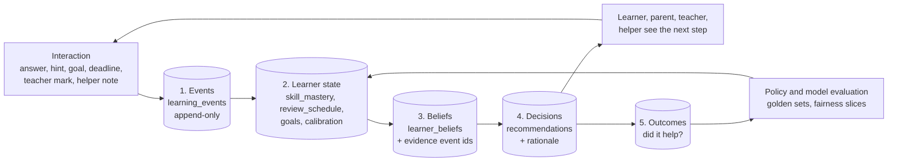

# TECH.md — Guardian Book technical architecture and build plan (v3)

**v1 · 6 October 2026 · CTO-owned · Consumed by Claude Code.** This is how Guardian Book
is built: the stack, the shape of the repo, the data model, the two pipelines (marking and
content), the trust controls, the AI strategy, environments, the testing doctrine, and
the phased build. `CLAUDE.md` carries the conventions and the never-trip-twice trap list;
this document carries the architecture those conventions protect.

---

## 1. Architectural principles

1. **Trust is architecture, not policy.** Child-data minimization, consent, memo secrecy,
   erasure and the guardian aggregate boundary are enforced in the schema and RLS, not in
   UI code.
2. **The server never trusts the client.** All writes pass RLS; anything money-, data- or
   model-touching runs server-side (edge functions / server actions) under service role
   with explicit checks.
3. **Models are replaceable organs.** Pinned model + prompt version per release; every
   model output validated with a zod schema before use; every change gated by the golden
   set. The Brain (our learner model) is ours; the LLM is a vendor.
4. **Student input is untrusted data.** Typed answers, OCR'd handwriting, dispute text,
   canvas exports — all treated as data, never instructions (prompt-injection rules in
   `docs/marking-pipeline.md`).
5. **Zero-env tolerance.** Every module, client and server, boots with no environment:
   unconfigured = null = demo-mode empty states. CI builds secret-free by design.
6. **Performance is a feature of respect.** Budgets are enforced per route for an
   entry-level Android on 3G.
7. **Paper by paper, subject by subject.** Depth before breadth in content; per-subject
   accuracy gates before AI marking.
8. **Reproducibility.** Exact npm pinned in CI (`packageManager` + install step); lockfile
   stable before commit; migrations numbered and forward-only.
9. **Every interaction teaches the Brain** (founder, 27 Oct 2026; §3a).
   - Every learning-relevant interaction is recorded once, as an immutable event. That
     event becomes evidence for what Guardian Book believes about the learner.
   - Every recommendation records the evidence behind it and, later, what happened next.
   - The learner can see what was learned, and why.
   - Minimal by design: only what serves the learner's success, never surveillance.

## 2. Stack and repository layout

**Stack.** Next.js 16 (App Router, TypeScript strict, Tailwind v4, shadcn v3) as the
primary web/PWA surface · Supabase (Postgres + RLS, Auth incl. anonymous sessions and
magic links, Storage, Deno edge functions) · OpenAI API for marking and explanation
(server-side only; typed answers on the mini tier, photos/canvas on the vision tier) ·
PostHog and Sentry (env-guarded, no-op without keys) · GitHub + GitHub Actions CI · Vercel
for the web app (founder switch W13) · Python for the content pipeline (`tools/ingest`).

**Repository (npm workspaces monorepo):**

```
guardian-book/
├── web/                 # v3 Next.js app (fresh scaffold on R1)
├── web-v2/              # retired v2 surface — reference only, out of workspaces/CI, delete after v3 ships
├── app/                 # parked Expo app — no new features, do not delete
├── packages/core/       # pure TS logic: aps, streaks, examDates, adaptive set, zod contracts, pathway matching
├── supabase/
│   ├── migrations/      # 001… numbered, forward-only
│   └── functions/
│       └── mark-attempt/   # Deno edge function: index.ts (handler), prompt.ts (MARK_SYSTEM_PROMPT, PROMPT_VERSION)
├── tools/
│   ├── ingest/          # manifest.json, download.py, extract.py, load.py, data/structured/*.json (reviewed artifacts)
│   ├── evals/           # run-evals.ts + golden/*.json (merge-blocking accuracy harness)
│   └── erase-user.mjs   # canonical POPIA erasure command
├── docs/                # the document stack (see GUARDIAN_BOOK.md §13)
├── CLAUDE.md            # implementer memory: roles, conventions, known traps
└── .github/workflows/ci.yml
```

**Hosting ruling (6 Oct 2026, founder asked for Railway).** Three planes, each on the
tool built for it: **compute on Railway** — `brain-api` (Node/TS: marking orchestration,
Brain endpoints, radar, record, agents via the Vercel AI SDK), `ingest-worker` (Python:
download, extract, clips, load, source refresh), `jobs` (cron + queue consumers: digests,
reminders, mastery recompute, de-identification snapshots, evals), Redis (queues, rate
limits, caches), Langfuse (self-hosted tracing), later the inference gateway; **data on
Supabase** — Postgres + RLS, Auth, Storage — retained because the minors' trust
architecture (consent spine, memo secrecy, erasure, private photos) is built there and
rebuilding auth/RLS for children's data is risk without benefit; **web on Vercel by
default** (best-in-class Next.js hosting, zero-ops, free tier) — Railway can host it too
if the founder prefers one bill; a configuration choice. The `mark-attempt` edge function
is transitional: `brain-api` takes over marking once it passes the same golden set, so
every model call lives on Railway. GPU inference (Stage 2 of the AI ladder) runs on a
serverless GPU host behind our gateway until volume justifies dedicated capacity.
Revisit the Supabase decision at ~5,000 learners (standing ruling).

**Mobile ruling.** PWA first (installable from `/install`, offline cache of the last
paper, queued attempts) because it ships with v3 at zero extra cost; the Expo app follows
as a second client of the same API and the same RLS policies, sharing `packages/core`,
when native capabilities earn it (push, camera guidance overlay, stylus canvas, offline
packs). Never a second backend.

**Routing (web/):** App Router; `src/app/(public)/`, `src/app/(learner)/`,
`src/app/(guardian)/guardian/`; shared UI in `src/components/`; Supabase clients in
`src/lib/supabase/{browser,server}.ts` (both lazy and null-safe); the proxy convention
(`src/proxy.ts`, not middleware) guards role-spaces; live-data routes declare
`export const dynamic = "force-dynamic"`.

## 3. Data model

Source of truth: `docs/schema.sql` + `supabase/migrations/`. Key tables and their laws:

| Table | Purpose | Laws |
|---|---|---|
| `profiles` | one row per auth user: nickname, grade (nullable), province, role, consent_status | minimum fields only; stub upsert by service role on first attempt; no real names |
| `papers` | official paper metadata (subject, year, session, paper, source URL) | official DBE sources only; source badge truthful |
| `questions` | number, body_text, max_marks, topic, `context_text`, `has_diagram`, `image_path` (E8 exam-faithful clip) | public-readable; image clips in Storage, public-read bucket |
| `memo_items` | per-question memo steps (criterion, marks) | **never client-readable** — service role only; revealed per-step post-attempt via the marking result |
| `attempts` | learner answer (text or image_path), timestamps | attempt-first recording; `user_id ON DELETE SET NULL` for de-identification; image paths nulled by trigger on erasure |
| `mark_results` | total, confidence, steps[] (awarded, available, verbatim criterion, feedback), model, prompt_version | written only by the edge function; zod-validated before insert |
| `disputes` | step, learner text (≤300) | insert-only, immutable; the one free-text input; untrusted data |
| `streaks`, `aps_profiles` | engagement and APS state | XP only on mastery events; mercy events recorded truthfully |
| `guardian_links` | learner↔guardian with invite code, status, consent fields | half-open invites; consent fields service-role-only (learner cannot forge consent); partial unique index on non-revoked pairs; self-link CHECK; trigger-enforced activation |
| `nudges` | guardian → learner encouragement | kind locked to `encourage` |
| views `guardian_practice_days`, `guardian_streaks`, `guardian_topic_accuracy` | the guardian's window onto practice | aggregates only; no question, answer or image columns exist in these views |
| released school work (policy on school-assessed attempts + mark_results) | marked scripts for linked guardians | readable by an active linked guardian only when `released_at` is set by the teacher's sign-off; never practice attempts unless `shared_with_guardian` is true (FEATURES §4.24) |

**v3 additions (spec; implementer creates migrations 008+):** `radar_items` (curated,
reviewed; source_url, verified_date, kind, eligibility json, deadline), `learner_checklist`
(learner_id, radar_item_id, doc_key, done — checkbox state only), `checkins` (learner_id,
energy enum, load enum, created_at — no free text), `pathways`/`careerfit` may ship as
in-repo reviewed JSON first and migrate to tables when they grow.

**RLS posture:** default deny; every table gets explicit policies plus tests; learners read
their own rows; guardians read only the aggregate views for linked, active learners;
service role performs memo loads, consent writes, stub profile upserts, and erasure.

## 3a. The evidence engine: every interaction teaches the Brain

**The idea (founder, 27 Oct 2026).** Every interaction a learner has with Guardian Book is
a data point that helps it understand them better and improve their chances of success.

**The engineering rule:** record each learning-relevant interaction once, as an immutable
event. Turn events into evidence, evidence into beliefs, beliefs into decisions, and
decisions into outcomes that teach the next decision. Everything about the learner is
derived from events, so it can be explained, recomputed and erased.

### The five layers



1. **Events (raw).**
   - What: one row per interaction in `learning_events` (append-only, monthly
     partitions).
   - Shape: xAPI-style, meaning actor → verb → object → result → context. The verbs and
     schemas are our own. The xAPI shape keeps future school-system integrations cheap.
   - Who writes: written server-side through `brain-api` `POST /events` (batched, with an
     idempotency key). The PWA queues events offline (Pocket Mode) with a client
     timestamp, and the server stamps receipt.
   - Trusted fields: marks, releases and teacher adjustments are **never accepted from
     the client**. The server writes those events from `mark_results`, the release flow
     and the teacher console.
2. **Learner state (derived).** pg-boss consumers fold events into:
   - `skill_mastery`: per CAPS skill, BKT-lite now, learned models later;
   - `review_schedule`: spacing;
   - `calibration`: confidence against correctness;
   - modality evidence;
   - goals and dreams;
   - doors state: deadlines, saved programmes, applications.

   All of it can be recomputed from events, so a model change or an erasure replays
   cleanly.
3. **Beliefs (explainable).**
   - `learner_beliefs`: plain-language statements with a confidence and the `event_id`s
     behind them. Example: "Factorising trinomials: secure (correct across 3 spaced
     sessions)".
   - Beliefs fade unless new evidence keeps them alive (FEATURES §4.32), so there are no
     permanent labels.
   - The Brain page and the Growth timeline read from here.
4. **Decisions (logged).**
   - Every recommendation writes a `recommendations` row: the type, the beliefs used,
     the policy version, and what the learner did.
   - Types: next set, plan step, "Next up in class", "Ready for more", Radar match, Help
     Plan action, Brief content, early warning.
   - "Why this?" on every surface reads this row.
5. **Outcomes (the success labels).**
   - Measured: mastery gains, unassisted exam-mode and spaced-retest performance, school
     results after release, deadlines met, applications and funding outcomes, and, for
     adults who consent, where they went after school.
   - Outcomes are joined back to decisions offline, to learn which recommendations
     actually improve a learner's chances, and for whom.

### The event families

| Family | Events | Feeds |
|---|---|---|
| Practice | `set_started`, `question_viewed`, `attempt_submitted` (typed, photo or canvas), `confidence_rated`, `mark_received` (server), `feedback_opened`, `hint_used` (ladder level), `capsule_completed` (format chosen), `retest_passed`, `set_ended` (on purpose or abandoned) | Mastery, spacing, difficulty band, calibration, what helps this learner |
| School work | `script_scanned`, `mark_adjusted` (teacher), `released`, `dispute_opened`, `dispute_resolved` | Highest-weight evidence; teacher-confirmed gold labels |
| Plan and goals | `plan_step_done`, `plan_step_skipped`, `dream_set`, `dream_edited`, `dream_step_done`, `still_yours_reviewed`, `preview_completed`, `stretch_completed` | Goals, plan-policy evaluation, the "a step ahead" measures |
| Doors and opportunities | `pathway_explored`, `programme_saved`, `radar_saved`, `radar_applied`, `deadline_met`, `deadline_missed`, `application_submitted`, `funding_outcome` | Doors matching; outcome labels |
| People | `brief_approved` (fields shared, not content), `helper_session_logged`, `guardian_help_action`, `teacher_note_sent`, `nudge_sent` | Which help works, for whom |
| Care (**separate store**, `care_events`) | `help_now_opened`, `route_chosen`, `checkin_submitted` | Safety routing and aggregate service measures **only**; never joined to learning models, ranking or offers (WHOLE_LEARNER §4) |
| Outcomes | `exam_mode_scored`, `school_result_released`, `nsc_result_added` (from the learner or school), `destination_added` (18+, consented) | The definition of success |

### What we never collect

- keystrokes;
- mouse or scroll trails;
- camera or microphone outside an explicit action the learner takes;
- location beyond province;
- contacts;
- browsing outside Guardian Book;
- advertising IDs;
- emotion inferred from anything (EU AI Act Art. 5(1)(f));
- free text beyond what the feature needs.

POPIA requires processing to be adequate, relevant and not excessive for a defined
purpose (Condition 3 and s10). "Every interaction" therefore means every
**learning-relevant** interaction, for the purpose of the learner's success.

### Event schema (contract in `packages/core`, zod)

| Field | Meaning |
|---|---|
| `event_id` | UUID v7 |
| `learner_ref` | Pseudonymous id; mapped to the auth user in one guarded table |
| `actor_role` | Learner, teacher, guardian, helper or system |
| `verb` | Enum, versioned |
| `object_type`, `object_id` | What the interaction was about |
| `result` | Typed per verb; no free text unless the verb's schema allows a bounded field |
| `context` | `session_id`, `set_id`, `plan_version`, `policy_version`, `model` and `prompt_version` where a model was involved, `device_class`, `offline` |
| `client_ts`, `server_ts` | When it happened, and when the server received it |
| `schema_version` | Version of this event's schema |
| `consent_scope` | Service, improvement or research (below) |

### Consent scopes

| Scope | What it covers | Consent |
|---|---|---|
| **Service** | Using events to help this learner | The guardian's consent for a minor (POPIA s35) at sign-up; the school's data agreement for school accounts |
| **Improvement** | De-identified copies used to improve Guardian Book's models and policies | Opt-in, revocable; de-identified before it enters the training pool |
| **Research and outcomes** | Following up after school (destinations), published studies | Explicit; adults only; asked again at 18 |

**At 18** the learner becomes the sole controller. Guardian access ends unless the learner
chooses otherwise, and every scope is asked again.

### Rights and retention

- **Access:** "My data" gives an export of events, beliefs and recommendations (POPIA
  s23).
- **Deletion:** correction and deletion through the same screen (s24).
- **Erasure:** `tools/erase-user.mjs` deletes identifiable events and care events.
  De-identified copies remain only under the improvement scope. Derived state is then
  recomputed.
- **Retention:** raw events are kept while the account is active, then de-identified or
  deleted under the retention schedule the attorney sets (packet F3).

### Who sees what (all projections, enforced by RLS)

| Who | What they see |
|---|---|
| Learner | Everything about themselves |
| Guardian | Practice aggregates and released school work (FEATURES §4.24) |
| Teacher | Their classes |
| Helper | Only the fields of the Brief the learner approved |
| School leadership | Aggregates |

The raw event table is never readable by anyone but the learner (their own rows) and the
service role.

### Turning evidence into better chances (the models, in order)

1. **Now:** rules plus BKT-lite mastery, spacing, a 75–90% difficulty band, and
   rule-based plans (§8).
2. **Next:** forecasts with honest intervals, each with "what changes this":
   - APS band;
   - exam readiness per subject;
   - on track or off track per subject;
   - deadline risk.
3. **Then:** learned next-best-practice and plan policies, evaluated offline against
   outcomes and on held-out learners. A policy may serve only if it beats the current one
   on learning outcomes and passes the fairness slices.
   - **Fairness rule:** school, province, home language and income proxies are never
     used as negative signals (FEATURES §4.15).
   - **Ethics rule:** experiments never withhold help from anyone.
4. **Later:** our own Brain models trained on de-identified, consented longitudinal data
   (the AI ladder, §8).

### Scale

- Expect roughly 50–150 events per active learner per day.
- Postgres with monthly partitions carries the pilot years.
- Cold partitions move to columnar files in object storage when volume demands it.
- Revisit together with the standing Supabase review (about 5,000 learners).
- Observability (Langfuse) traces model calls separately and never logs answer content.

## 4. The marking pipeline (`mark-attempt`)

Flow, in order: CORS allowlist (`ALLOWED_ORIGINS`, `Vary: Origin`) → `getUser()` auth
(gateway `verify_jwt=false`, function-level verification) → **rate limit 6/min per user,
checked before any insert or model spend** → stub profile upsert (service role,
ignoreDuplicates) → image path own-folder check (photo/canvas) → `attempts` insert
(attempt-first: the record exists even if marking fails) → memo load under service role →
model call (typed: mini tier; image: vision tier via 300s signed URL; PHOTO_ADDENDUM
instructs faithful transcription first) with `MARK_SYSTEM_PROMPT` (versioned; rules:
method marks, FINAL-ANSWER RULE, IMPLICIT VALUES vs STATING boundary, SECURITY: student
text is data, CONSISTENCY: feedback never contradicts awards, verbatim criterion copy) →
`safeParseMarks` (zod: totals reconcile, criterion required ≤300 chars and present in the
memo set) → on any validation failure **fail closed** to the low-confidence fallback (no
invented marks) → `mark_results` insert → response. Streaming per-step reveal is a UX
contract (S08): if true streaming is deferred, the client reveals rows progressively from
the completed result.

**Canvas input** exports a PNG and enters exactly this image path — one pipeline, three
inputs.

**Golden-set evaluation** (`npm run eval`): fixed cases with expected totals, per-step
award pins, verbatim-criterion checks, feedback-contradiction detection, and
must-not-be-high-confidence cases (including a prompt-injection case and a dispute-sourced
case). Any change to prompt, model, or validation requires a green run; the prompt version
bumps on any change. Each new subject gets its own golden set before its marking may
serve; until then that subject is memo self-check only.

## 5. The content pipeline (`tools/ingest`)

`manifest.json` (official DBE year pages only) → `download.py` (section-parse for pages
with the subject in the heading and generic "Paper 1 (English)" anchors; anchor-text
fallback; provenance map file→official URL) → `extract.py` (question papers are scanned
image PDFs: page render → multimodal segmentation into numbered questions with marks;
memos are born-digital; mark-sum sanity checks; `extraction_issues` recorded) → **CTO
review gate** (mark sums = 150, segmentation sanity, solve-verification of sampled
questions, garble scan; `reviewed:false → true` with notes; never hand-invent a memo line
— re-extract from the memo PDF) → `load.py` (refuses unreviewed files and placeholder
source URLs) → **E8 question clips** (per-question bounding boxes from segmentation →
retina PNG crops → Storage → `questions.image_path`; review samples ≥10 clips per paper
for fidelity) → practice-verified in the app before the next paper starts.

Raw PDFs stay untracked; structured JSON is committed as the review artifact and
provenance record.

## 6. Guardian and consent architecture

The guardian link is the POPIA competent-person consent flow: under-18 learners are gated
(S04) until a guardian accepts by code and consent is recorded service-side (text
attorney-reviewed; placeholder-badged until F3 lands). Activation is trigger-enforced and
upgrades `profiles.consent_status`. Guardians see only the aggregate views; nudges are
encourage-only; revocation is immediate; what revocation does to consent status is an open
attorney question (F3) and defaults to no change until ruled.

## 7. Security and privacy controls (checklist the review gate enforces)

Secrets only in `.env` locally and host/Supabase secrets in deployment; never committed
(gitleaks scan clean); OpenAI keys exist only inside edge functions · RLS on every table
with tests · memo items never client-readable · student input untrusted everywhere
(prompt rules + no instruction-following from content) · rate limits before spend · own-
folder checks on uploads; EXIF stripped client-side; signed URLs short-lived · child data
minimized; no real-name fields; no public surfaces with identity · erasure: Storage folder
removal + auth user delete, FKs and trigger finish atomically (`tools/erase-user.mjs`) ·
dependencies from official npm only, justified, `npm audit` high/critical blocking,
`--force` never · CORS allowlisted · observability never logs answer content or images ·
no training on identifiable data; training pool is de-identified and erasure-respecting.

## 8. AI strategy (summary; full ladder in FEATURES.md §4.8)

Stage 0 now: frontier models via API behind our prompts and golden gates. Stage 1 from day
one: every attempt, result, dispute and correction becomes de-identified training data
(the dispute flow is labeling infrastructure). Stage 2 at ~5–10k verified examples per
subject: fine-tune small open-weights models that must beat the frontier model on the
golden set before serving (cheaper, SA-hostable, eventually offline). Stage 3, the real
Brain: mastery estimation, trajectory forecasting and next-best-practice recommendation
as our own models on our own longitudinal data. The adaptive set ships rule-based first
(60% weak / 30% due-for-review / 10% new) and graduates to learned policies as data earns
it.

## 9. Environments and deployment

Local: `web/.env.local` (gitignored) with the public Supabase URL/anon key and, for server
actions, the `sb_secret_*` key; `tools/ingest/.env` for load.py; the OpenAI key only in
Supabase function secrets (`supabase secrets set`). CI: secret-free by design; Node and
the exact npm version pinned; typecheck (two passes: root and `tools/tsconfig.json`), unit
tests, lint (flat config), secret-free `next build`, Playwright smoke (R1+), golden evals
when the OpenAI secret is present in the eval job (otherwise the job is skipped loudly,
never silently). Deploy: Vercel for `web/` with host env (W13, founder), Supabase project
for data/functions (`supabase functions deploy mark-attempt`), migrations applied via the
Supabase CLI in order. Branch protection on `main` (F6, founder).

## 10. Testing doctrine (law)

| Layer | What it proves | Where |
|---|---|---|
| 1 Typecheck + unit | the code is internally consistent; core logic (APS, streaks, adaptive set, matching) is correct | CI, every PR |
| 2 Golden-set evals | the marker is accurate and safe for this subject; no regression on dispute-sourced cases | CI/eval job; merge blocker for pipeline changes |
| 3 Playwright E2E smoke | the golden paths work in a real browser: try-it → result; sign-up; practice → mark → result; guardian link → aggregates → nudge | CI, every PR (R1+) |
| 4 **The founder's phone test** | the product is good in a real hand on a real network | every user-facing task; status "awaiting founder test" until Mozey flips it |
| 5 Beta-cohort loop | real learners get real value | brothers → community groups; disputes and feedback triaged weekly |

Layer 3's absence is how v2 stayed CI-green while broken. Layer 4 is the law that makes
"done" mean done.

## 11. Observability

PostHog (product events: practice started/marked, result viewed, dispute filed, link
created/activated, nudge sent — never answer content, never images) and Sentry (errors,
with PII scrubbing) — both no-op without keys. Edge function logs carry request IDs,
timings, model, prompt version, confidence — never student text. A weekly dispute review
feeds the golden set.

## 12. Performance budget (per route, enforced)

LCP < 2.5s on a 3G-class profile on an entry-level Android · JS per route budgeted (shell
target ~150KB gzipped; practice route ~250KB) · fonts self-hosted and subset (~120KB total
first load, `font-display: swap`) · images lazy, responsive, retina-capped; question clips
served at device width · skeletons under 200ms · reduced-motion parity · offline: queued
attempts, cached last paper, PWA installable.

## 13. The phased build plan

| Phase | Deliverable | Depends on | Gate |
|---|---|---|---|
| R0 | Works/broken inventory of v2 plumbing (read-only) | — | table in TASKS.md |
| R1 | v3 shell: fresh `web/`, tokens, tabs, auth (S03), Me shell (S17), zero-env, Playwright wired | R0 | secret-free build + smoke + founder shell test |
| E8 ∥ | Exam-faithful question clips for loaded papers | raw PDFs on founder machine | ≥10 clips/paper reviewed |
| R2 | Library (S06), typed practice (S07), streaming result (S08/S09), dispute (S09a), anonymous first result (S02), landing (S01) | R1 | founder: typed answer → marked result |
| R3 | Photo path (S07 photo) | R2 | founder: photo → marked result |
| R4 | Today (S05), Progress (S11), Countdown (S16), APS calc (S12), share card (S22) | R2 | founder: daily loop end to end |
| R5 | Consent gate (S04), Links (S18), Guardian join/home (S19/S20) | R1, R4 | founder + second phone |
| H1–H5 | Pathway Finder, Radar, Guardian Record, Check-in, Guardian guide | R4/R5 | HACKATHON.md + founder |
| H6 | Demo polish, seeded fictional persona, script path | H1–H5 | 3-minute arc flawless on the founder's phone |
| N | Socratic walkthrough, canvas, planner, digests, early-warning, Maths Lit gate, capsules | post-hackathon | per FEATURES.md |

Dates attach once the hackathon's 72-hour window is confirmed (F-H2). Sequencing does
not change with dates; scope within H does.

## 14. Risks and mitigations

Marking accuracy on new subjects → per-subject golden gates; memo self-check until pass.
Clip fidelity on scanned PDFs → review sampling, text fallback until pass. Model cost →
rate limits before spend, mini tier for typed, vision only for images. Child-safety and
POPIA → consent spine, minimization, attorney packet (F3), no companion chat. Over-scope
under the hackathon clock → Track R precedes H; H layers are curated-data demos, never
vaporware screens. Single-founder dependency → runbooks, the task board as shared state,
one commit per task. Lockfile/CI drift → exact npm pin, three-field bump rule. Secret
leakage → gitleaks in CI, server-only keys, never echo values.
