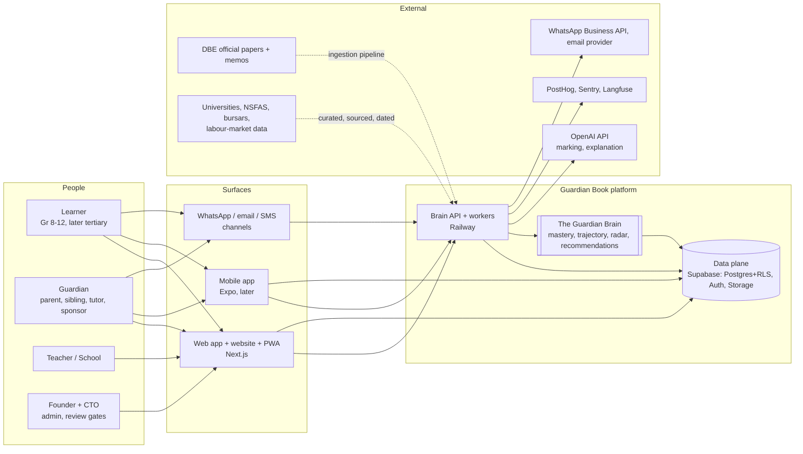
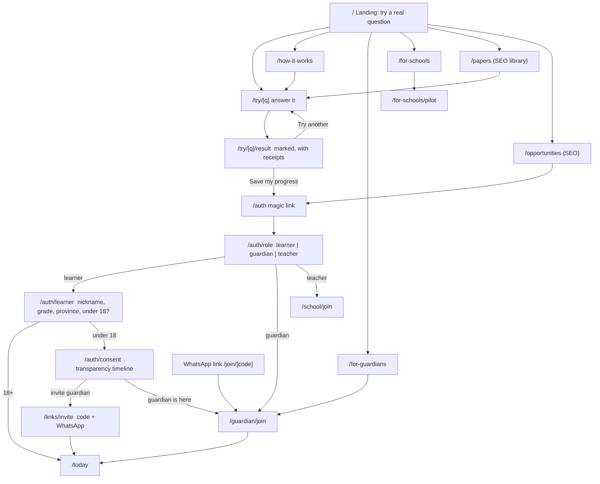
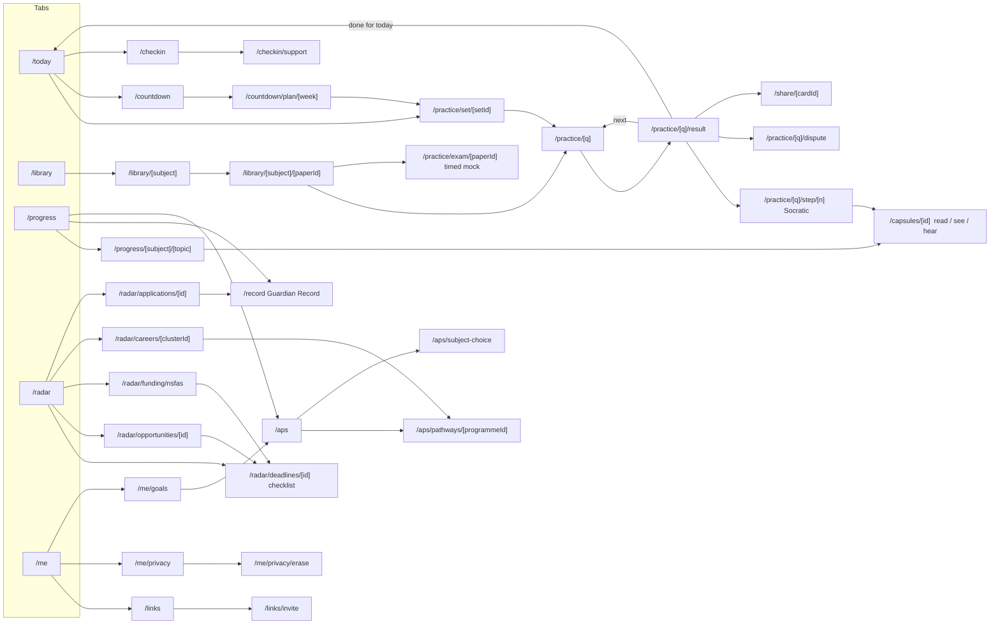
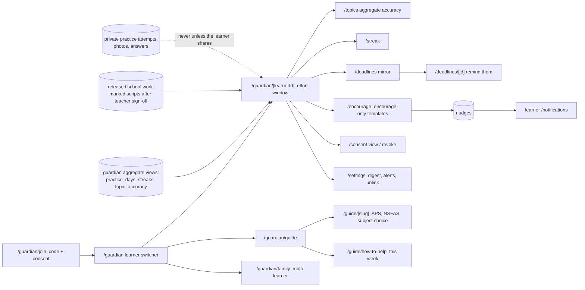
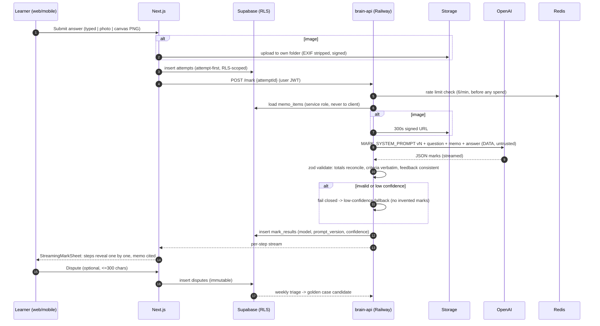
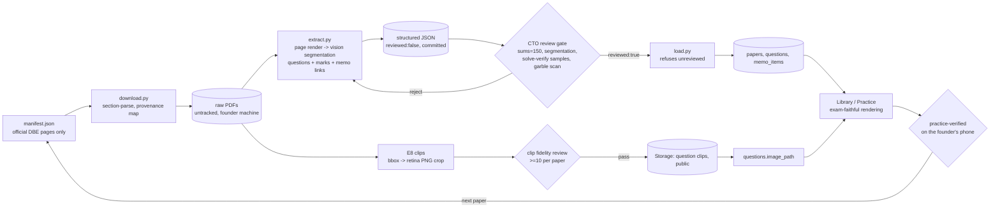
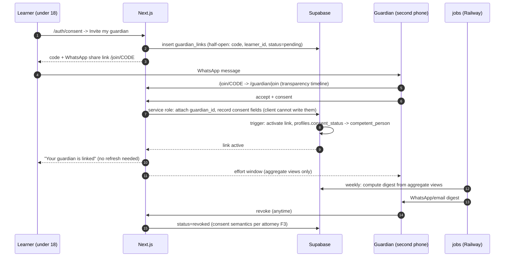
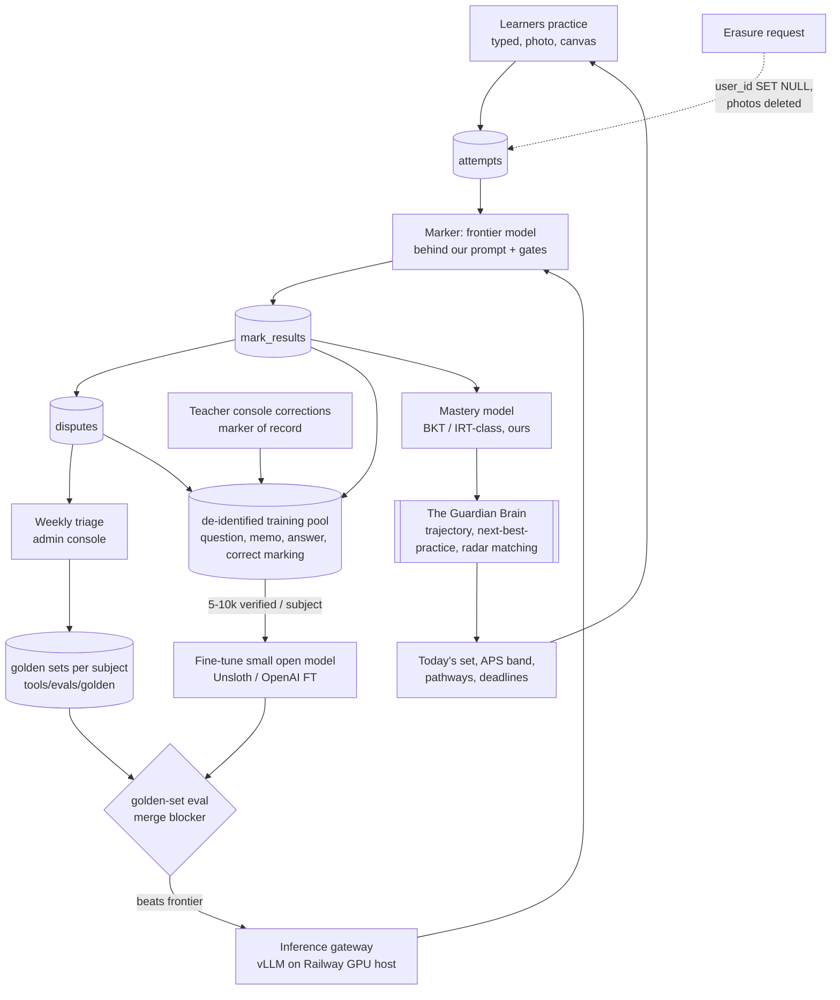
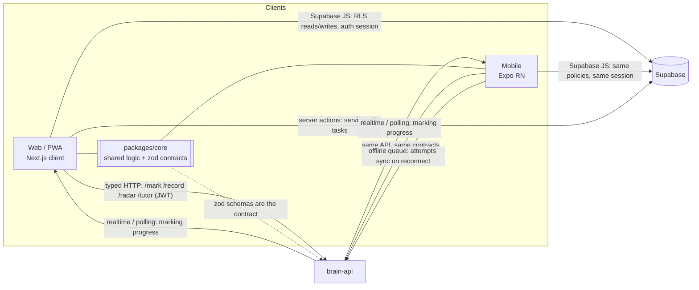
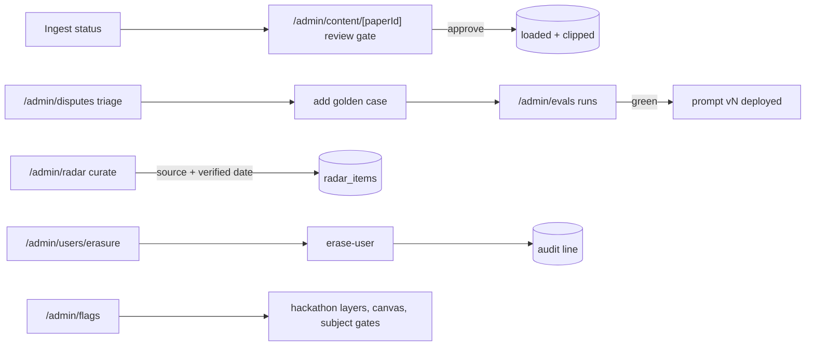

# WIRE_DIAGRAMS.md — how everything connects

**v1 · 6 October 2026 · CTO-owned.** The wire diagrams of Guardian Book: who talks to
what, how a visitor becomes a learner, how a learner's answer becomes a mark, how a paper
becomes practice, how a guardian is linked, how the data becomes our own AI, and how the
web app, the mobile app and the backend communicate. Diagrams are Mermaid (GitHub renders
them in place); a rendered page is published alongside. Routes referenced are in
`docs/SITEMAP.md`; screen contents in `docs/SCREENS.md`; the stack in `docs/TECH.md`.

---

## 1. System context — who talks to what



Every human reaches the platform through the web app (which is also the website and the
installable PWA), later the mobile app, and the messaging channels. All surfaces speak to
the same two things: the **Brain API and workers on Railway** (compute: marking
orchestration, the Brain's models, radar, digests, ingestion) and the **data plane on
Supabase** (Postgres with row-level security, Auth, Storage). The Brain is a set of
models and jobs that read and write the data plane; it is ours. OpenAI is a replaceable
organ behind the API. Official sources enter only through the ingestion pipeline and the
curated-dataset gate.

## 2. Deployment — the containers and where they run

```mermaid
flowchart TB
  subgraph Vercel["Vercel (or Railway) — web"]
    NEXT[Next.js app<br/>website + learner + guardian + school + admin<br/>PWA, server actions, proxy guards]
  end

  subgraph Railway["Railway — compute"]
    BAPI[brain-api<br/>Node/TypeScript<br/>marking orchestration, radar, record, agents]
    ING[ingest-worker<br/>Python<br/>download, extract, clips, load]
    JOBS[jobs<br/>cron + queue consumers<br/>digests, reminders, mastery recompute, evals]
    REDIS[(Redis<br/>queues, rate limits, caches)]
    INF[inference gateway<br/>later: fine-tuned models via vLLM]
  end

  subgraph Supabase["Supabase — data plane"]
    PG[(Postgres + RLS<br/>profiles, papers, questions, memo_items,<br/>attempts, mark_results, disputes, streaks,<br/>guardian_links, nudges, radar_items...)]
    AUTH[Auth<br/>magic links, anonymous sessions, roles]
    STO[Storage<br/>answer photos (private), question clips (public)]
    EDGE[mark-attempt edge function<br/>transitional; retired once brain-api passes the golden set]
  end

  subgraph Ext["External services"]
    OAI[OpenAI API]
    LF[Langfuse tracing]
    PH[PostHog]
    SE[Sentry]
    WAB[WhatsApp Business API]
    EM[Email provider]
  end

  NEXT -- RLS-scoped reads/writes, auth --> PG & AUTH & STO
  NEXT -- typed HTTP, user JWT --> BAPI
  BAPI -- service role --> PG & STO
  BAPI --> REDIS & OAI & LF & INF
  ING --> PG & STO
  JOBS --> PG & REDIS & WAB & EM & OAI
  NEXT --> PH & SE
  BAPI --> SE
  EDGE -. transitional .-> OAI & PG
```

**Hosting ruling (6 Oct 2026).** The founder wants Railway for the backend; the CTO agrees
for **compute**: Railway hosts our own services (`brain-api`, `ingest-worker`, `jobs`,
Redis, later the inference gateway) because they are long-running, need Python and
Node side by side, need queues and cron, and will grow into model hosting. **Supabase stays
as the data plane** because the trust architecture — row-level security, minors'
consent spine, erasure, memo secrecy, private photo storage — is already built there and
rebuilding auth and RLS for children's data from scratch is risk with no benefit. The
Next.js app deploys to Vercel by default (best-in-class for Next, zero-ops, free tier);
if the founder prefers one bill, Railway can host it too — a configuration choice, not an
architectural one. Decision revisited at ~5,000 learners (as previously ruled). The
`mark-attempt` edge function is transitional: `brain-api` takes over marking once it
passes the same golden set, so all model calls live on Railway.

## 3. From the landing page to a learner — the front door



The decision psychology is built into the wiring: the easy question comes first, the
value is felt before any account exists, the anonymous attempt survives sign-up, and the
under-18 gate is a transparency timeline rather than a wall. Guardians arrive through
their own door (`/for-guardians`, `/join/[code]`) and never pass through learner
onboarding.

## 4. The learner app — tab-level wiring



Every result screen has exactly one forward edge the learner is pushed toward (next
question or done for today) and two optional edges (reclaim a step, dispute). The Radar
and APS surfaces converge on the same two objects — a deadline checklist and a programme
— so a career cluster, an opportunity and an NSFAS step all end in the same tracked
action. Progress feeds the Record; the Record pre-fills applications.

## 5. The guardian space — wiring and the aggregate boundary



The dotted "never" edge is the most important line in the diagram: there is no path from
a learner's private practice to any guardian page unless the learner shares it. School
work is different: once the teacher signs off and releases it, the marked script reaches
the guardian like a marked test sent home (FEATURES §4.24). The aggregate views contain no
question, answer or image columns by construction; released scripts reach guardians
through their own release-gated policy; the nudge table only accepts `encourage`.

## 6. Marking — from answer to mark sheet



The order matters: the attempt is recorded before the model is called (a failed marking
never loses the learner's work), the rate limit is checked before any money is spent, the
memo never leaves the server, the model's output is validated before it touches the
database, and anything that fails validation fails closed. The dispute closes the loop
into the golden set.

## 7. Content — from an official PDF to exam-faithful practice



Paper by paper: nothing moves to the next paper until this one is practice-verified.
Memos are born-digital and are never hand-written by us; a bad memo line is re-extracted
from the memo PDF.

## 8. Guardian link and consent — the spine



## 9. The data flywheel — how the product trains our own AI



The loop is the moat: every marked answer and every dispute becomes a labeled example,
every teacher sign-off is a gold label, the golden sets gate every change, and the Brain's
own models learn from verified mastery evidence — never from identifiable data, and
always erasure-respecting.

## 10. Web, mobile and backend — the communication contract



The clients are thin: they read and write the data plane directly under RLS, call the
Brain API for anything that computes or spends, and share every rule (APS, streak,
adaptive set, contracts) through `packages/core` so web and mobile cannot drift. The API
contract is the zod schema; the mobile app is a second client of an API that already
exists, not a second backend.

## 11. The review gates — the admin console in the wire



Nothing reaches a learner without passing through one of these doors: content through
the review gate, model changes through the eval runs, radar rows through the curation
gate, and erasure through an audited tool.
